<div align="center">

# Hey, I'm Ramiro 👋

### I build resilient platforms and agentic systems that hold up in production.

<samp>agentic workflows · harness engineering · platform engineering · cloud reliability</samp>

</div>

I design and operate cloud-native platforms with a focus on **resilience, automation, and operational simplicity**. Increasingly, that means building the infrastructure and engineering harnesses that turn capable AI models into dependable, observable systems.

My work sits where Kubernetes, multi-cloud infrastructure, agentic AI, security, observability, and real-world failure modes meet.

> Infrastructure should scale with the business, not with operational pain.

### What I'm building

- Building active-active, multi-region Kubernetes platforms
- Modernizing legacy infrastructure without disrupting production
- Designing production-grade agentic workflows with tools, memory, and human checkpoints
- Engineering agent harnesses: context assembly, execution boundaries, retries, and durable state
- Adding evaluation, tracing, guardrails, and failure analysis to AI delivery loops
- Improving observability, delivery safety, performance, and cloud cost across the stack

### Agentic systems & harness engineering

I care about the **whole system around the model**. A good demo is easy; a useful agent needs clear contracts, the right context, safe tools, measurable outcomes, and predictable behavior when dependencies fail.

| Area | What I focus on |
|---|---|
| **Agentic workflows** | Tool-using agents · multi-step planning · human-in-the-loop flows · multi-agent coordination |
| **Harness engineering** | Context engineering · MCP integrations · sandboxed execution · state and checkpointing |
| **Quality & safety** | Evals · tracing · guardrails · replayable runs · structured failure analysis |
| **AI platform** | Model gateways · workload orchestration · secure tool access · scalable inference foundations |
| **Developer experience** | Automation that reduces toil while keeping engineers in control |

### The toolbox

| | |
|---|---|
| **Cloud & orchestration** | AWS · Azure · GCP · Kubernetes · Docker · Helm |
| **Infrastructure as code** | Terraform · Pulumi · CloudFormation |
| **Delivery** | GitHub Actions · GitLab CI · Jenkins · Argo CD |
| **Reliability & security** | Prometheus · Grafana · ELK · IAM · Zero Trust |
| **AI engineering** | Agentic workflows · MCP · Evals · Context engineering · LLM observability |
| **Foundations** | Go · TypeScript · Python · Linux · Networking · Distributed Systems · SRE |

<p align="center">
  
  
  
  
  
  
  
</p>

### By the numbers

<!-- cool-readme:start -->
<p align="center">
  <picture>
    <source media="(prefers-color-scheme: dark)" srcset="https://raw.githubusercontent.com/rdecatri/rdecatri/cards/summary-dark.svg">
    
  </picture>
  <picture>
    <source media="(prefers-color-scheme: dark)" srcset="https://raw.githubusercontent.com/rdecatri/rdecatri/cards/languages-dark.svg">
    
  </picture>
</p>
<p align="center">
  <picture>
    <source media="(prefers-color-scheme: dark)" srcset="https://raw.githubusercontent.com/rdecatri/rdecatri/cards/contributions-dark.svg">
    
  </picture>
  <picture>
    <source media="(prefers-color-scheme: dark)" srcset="https://raw.githubusercontent.com/rdecatri/rdecatri/cards/streaks-dark.svg">
    
  </picture>
</p>
<!-- cool-readme:end -->

<details>
<summary><strong>When I'm away from production</strong></summary>
<br>

You'll usually find me experimenting in my home lab, building AI automations, gaming, or making music and DJing.

```yaml
learning: always
automation: preferred
coffee_dependency: critical
```

</details>
