<div align="center">

# Hey, I'm Ramiro 👋

### I build platforms that stay boring when everything else gets interesting.

<samp>platform engineering · distributed systems · cloud reliability</samp>

</div>

I design and operate cloud-native platforms with a focus on **resilience, automation, and operational simplicity**. My work sits where Kubernetes, multi-cloud infrastructure, security, observability, and real-world failure modes meet.

> Infrastructure should scale with the business, not with operational pain.

### What I'm working on

- Building active-active, multi-region Kubernetes platforms
- Modernizing legacy infrastructure without disrupting production
- Improving observability, delivery safety, performance, and cloud cost
- Exploring agentic automation and practical AI infrastructure

### The toolbox

| | |
|---|---|
| **Cloud & orchestration** | AWS · Azure · GCP · Kubernetes · Docker · Helm |
| **Infrastructure as code** | Terraform · Pulumi · CloudFormation |
| **Delivery** | GitHub Actions · GitLab CI · Jenkins · Argo CD |
| **Reliability & security** | Prometheus · Grafana · ELK · IAM · Zero Trust |
| **Foundations** | Linux · Networking · Distributed Systems · SRE |

### By the numbers

<!-- cool-readme:start -->
<p align="center">
  <picture>
    <source media="(prefers-color-scheme: dark)" srcset="https://raw.githubusercontent.com/rdecatri/rdecatri/cards/summary-dark.svg">
    
  </picture>
  <picture>
    <source media="(prefers-color-scheme: dark)" srcset="https://raw.githubusercontent.com/rdecatri/rdecatri/cards/languages-dark.svg">
    
  </picture>
</p>
<!-- cool-readme:end -->

<details>
<summary><strong>When I'm away from production</strong></summary>
<br>

You'll usually find me experimenting in my home lab, building AI automations, gaming, or making music and DJing.

```yaml
learning: always
automation: preferred
coffee_dependency: critical
```

</details>
